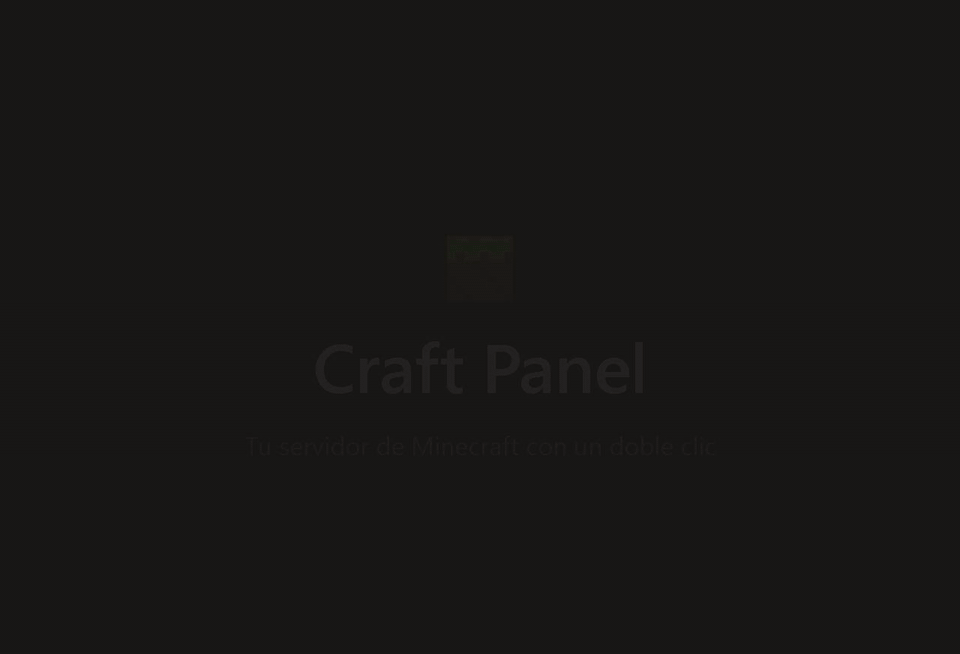
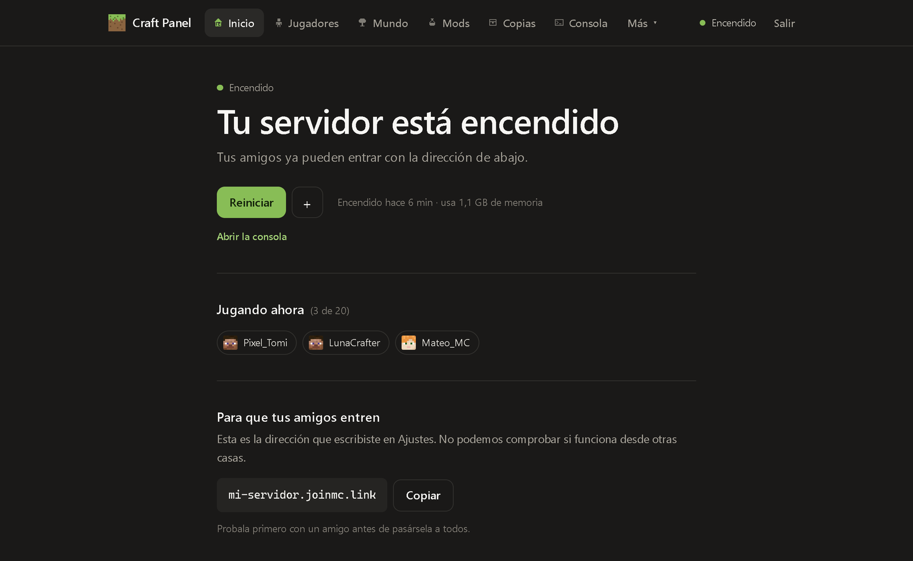
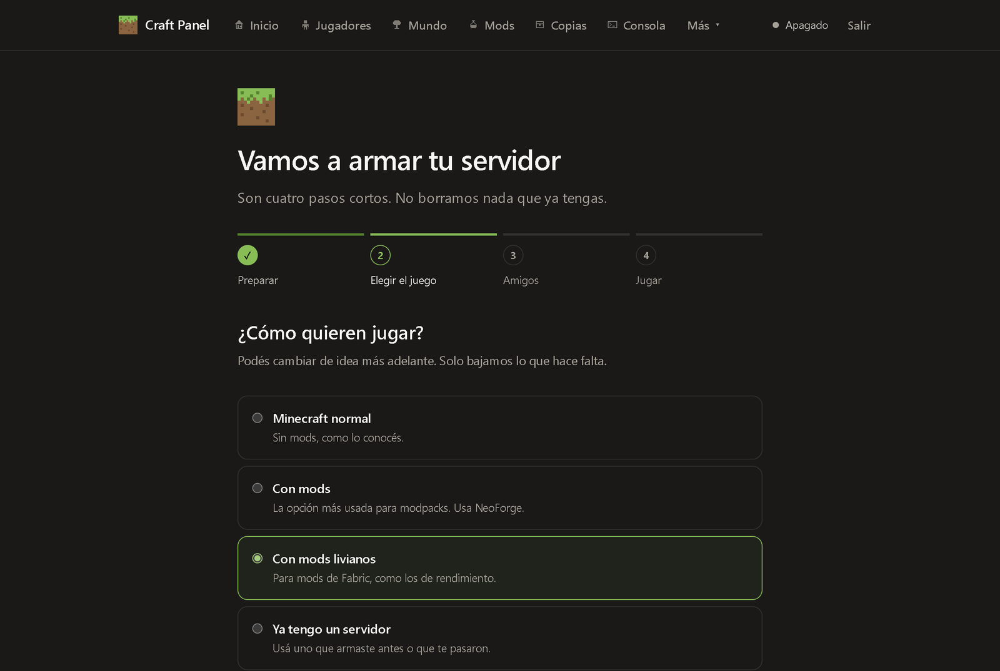
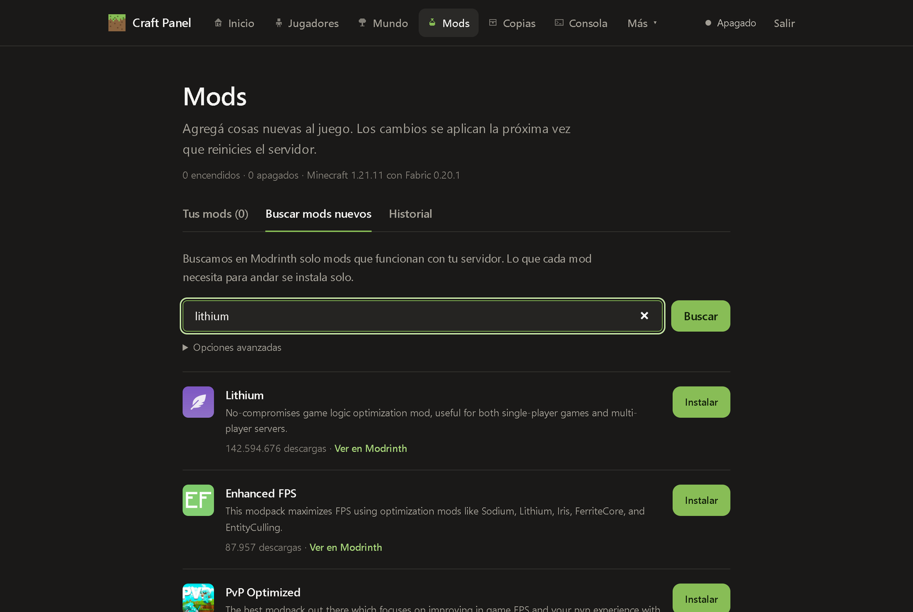
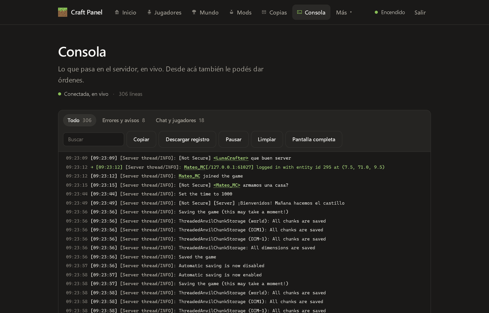
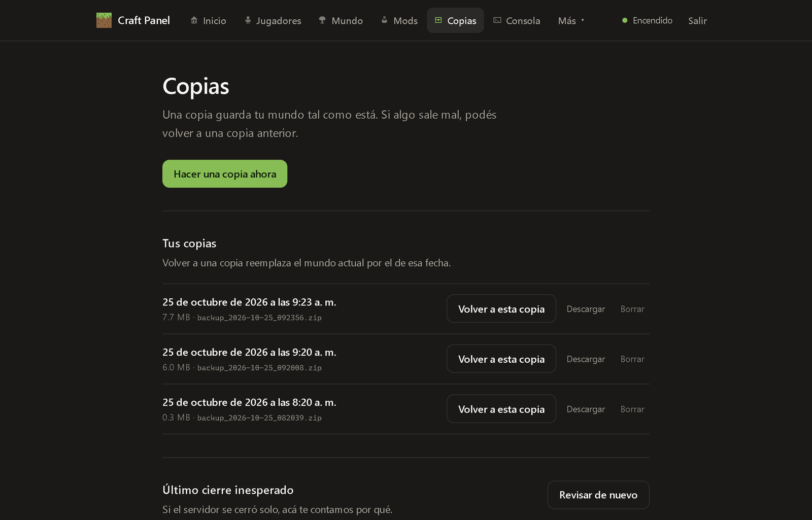
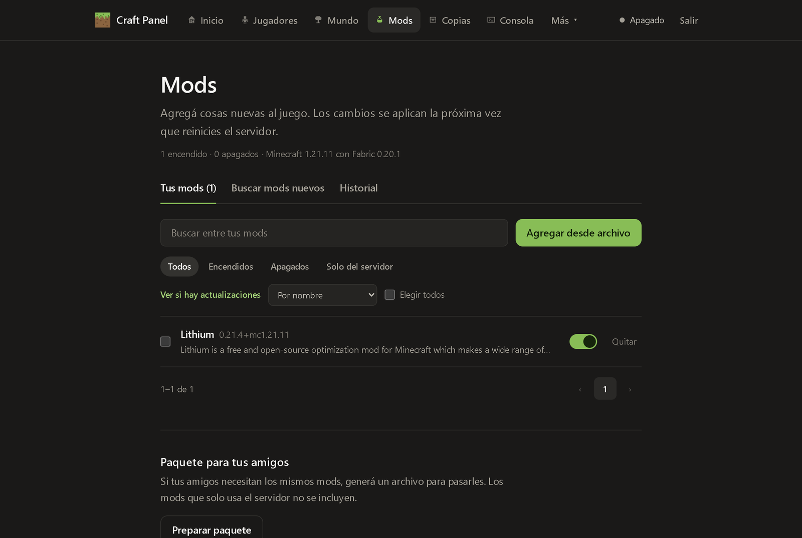

<div align="center">

# Craft Panel

**Your own Minecraft server in one double-click. No commands, no port forwarding, no Java headaches.**

A free, open-source web panel that installs, starts and shares a Minecraft server from a Windows PC, made so a kid or any non-technical player can host a private server for their friends.

[](https://github.com/finktech-dev/craft-panel/releases/latest)
[](https://github.com/finktech-dev/craft-panel/actions/workflows/tests.yml)
[](#compatibility)
[](LICENSE)

[**Download Craft Panel**](https://github.com/finktech-dev/craft-panel/releases/latest/download/CraftPanel.zip) · [Leer en español](README.es.md) · [Panel guide](docs/PANEL_GUIDE.md)



<sub>Recorded from the real panel on a fresh Windows install: the server, the players joining and every screen are real; nothing is mocked up.</sub>

</div>

## What it does

- **Guided setup:** pick normal Minecraft, NeoForge or Fabric and a version; the panel downloads the server (and the right Java if yours is too old) and starts it.
- **Friends can join from their homes** through [Playit.gg](https://playit.gg/) or a VPN like Tailscale, with the address ready to copy. No router settings.
- **Mods from Modrinth** in one click, with their dependencies, plus a ZIP of the same mods for your friends.
- **Automatic world backups** you can restore, download or keep on another drive.
- **A console that explains itself:** real errors highlighted, chat mode, search and one-click shortcuts.
- **Who is playing**, players, worlds, game rules, ranks (LuckPerms) and Discord notices, all in plain Spanish words.
- **Tells you when a new version is out**, and updating never touches your worlds.

| | |
| --- | --- |
|  |  |
| **Home:** is it on, who is playing, the address for friends. | **Setup:** four short steps, nothing to type. |
|  |  |
| **Mods:** only mods that fit your server, dependencies included. | **Console:** live, with chat and errors called out. |
|  |  |
| **Backups:** automatic copies, restore in one click. | **Your mods:** turn them on or off, send the pack to friends. |

The panel speaks Spanish; these docs are in English, with on-screen words kept as the panel shows them. [Leé esta página en español](README.es.md).

## Getting started

Craft Panel runs on **Windows 10 and Windows 11**. The first start needs an Internet connection.

**1. Get the panel and open it.**

1. Download **[CraftPanel.zip](https://github.com/finktech-dev/craft-panel/releases/latest/download/CraftPanel.zip)** from the [latest release](https://github.com/finktech-dev/craft-panel/releases/latest).
2. Right-click the downloaded ZIP and choose **Extract All…**. Extract it to a simple folder that OneDrive does not sync, for example `C:\CraftPanel`. Avoid Desktop and Documents when OneDrive backs them up.
3. Open the extracted folder and double-click **`iniciar_panel.bat`**. If Windows shows a warning about files from the Internet, click **More info** → **Run anyway** (or **Run**).

The first start takes a few minutes: the window finds Python (or installs it for you) and prepares the panel. When it is ready, the panel opens in your browser. Keep that black window open while you use the panel: closing it, pressing Ctrl+C in it or signing out of Windows also stops the server, saving the world first (to keep the server running instead, turn off `stop_with_panel`, see [the settings file](docs/SERVER_FILE.md)). Save the password shown on the first screen.

For a tour of every screen, read the [panel guide](docs/PANEL_GUIDE.md).

If you know Git, you can use `git clone` instead of the ZIP and then double-click `iniciar_panel.bat` in the cloned folder.

### Updating

When a new version is out, the home screen says so (turn this off with `check_updates = false` in [the settings file](docs/SERVER_FILE.md)). To update:

1. Close the panel's black window, which also saves and stops the server.
2. Download the new **CraftPanel.zip** and extract it.
3. Copy everything from the new folder into your Craft Panel folder and choose **Replace the files in the destination**.
4. Double-click `iniciar_panel.bat` again.

Your worlds, backups, mods and settings live in files the ZIP does not include, so they stay as they are. Making a backup before updating never hurts.

**2. Install Playit so friends can join from their homes.**

Download the Windows app from [playit.gg/download](https://playit.gg/download), install it, open **Playit.gg** from the Start menu and sign in. Nothing else to configure in the panel: it notices Playit on its own. Playing only on the same Wi-Fi? Skip this step.

**3. Follow the panel's steps.**

1. **Java**: if your computer already has a good Java, this step is skipped. If not, click **"Descargar Java"** (Download Java).
2. **"Tipo de servidor"** (Server type): pick normal Minecraft, mods (NeoForge or Fabric), or bring a server you already have.
3. **"Amigos"** (Friends): write your friends' Minecraft names. With Playit running, click **"Usar la dirección de mi Playit"** (Use my Playit address) (or paste the address Playit shows you).
4. **"Jugar"** (Play): click **"Encender"** (Start). When the server is ready, the panel shows the address to send to your friends.

### If something goes wrong

- **"Windows protected your PC" or "Open File - Security Warning"**: click **More info** → **Run anyway**, or **Run**. Windows asks this for files downloaded from the Internet.
- **"Primero hay que descomprimir el ZIP"** (You need to extract the ZIP first): you opened the file from inside the ZIP. Extract it first (step 1.2).
- **Typing `python` opens the Microsoft Store, or Python cannot be found**: the launcher installs Python with Windows Package Manager when it can. If it still fails, install Python 3.11 or newer from [python.org](https://www.python.org/downloads/) with **Add python.exe to PATH** checked, and in Windows Settings search **App execution aliases** and turn off `python.exe` and `python3.exe`.
- **"Python se instalo, pero esta ventana todavia no lo encuentra"** (Python was installed, but this window cannot find it yet): close the window and double-click `iniciar_panel.bat` again.
- **"No se pudo borrar la carpeta .venv"** (The .venv folder could not be deleted): close other panel windows and try again. The launcher rebuilds a broken `.venv` folder on its own.
- **Files disappear or the panel fails inside OneDrive**: move the whole folder to one OneDrive does not sync, such as `C:\CraftPanel`.
- **Playit is installed but the panel says it is off**: the Playit service starts by hand. **"Encender"** turns it on for you, or open **Playit.gg** from the Start menu. To have it start with Windows, open **Services**, double-click **playitd** and set **Startup type** to **Automatic** (Windows asks for permission).
- **The panel cannot find your Playit address**: copy the address shown in the Playit app or on playit.gg and paste it in **"Pegá la dirección que te muestra Playit"** (Paste the address Playit shows you).
- **Java is too old for the Minecraft version you chose**: click **"Instalar"** (Install) anyway. The panel downloads the right Java into `tools/java` first, without changing the Java installed in Windows.
- **The browser did not open**: open `http://127.0.0.1:8080` yourself while the black window is open.

## Personal open-source project

I built this for my own server and am sharing it openly so friends can use it, adapt it, and improve it. It is a personal project, not a polished hosting product: expect rough edges and possible bugs. Back up your worlds before relying on it.

This project is not affiliated with, endorsed by, or associated with Mojang Studios, Microsoft, or Minecraft.

## What the panel controls

- Minecraft server lifecycle: start, graceful restart, normal stop, and emergency stop.
- Launch RAM: written to the server's `user_jvm_args.txt` right away; when `server/craftpanel.txt` exists, its `memory` value is the one that counts and is kept in step.
- Backups, mods, worlds, player access, and Playit.gg connection status.
- A console with real error levels, folded Java errors, search, clickable player names, a chat mode and a log download that hides players' addresses.
- Mod updates from Modrinth and a history that can undo any mod change.
- A menu you can arrange: choose which pages stay in the bar.
- Mod installation from the panel: upload compatible `.jar` files, search Modrinth, install required Modrinth dependencies, enable or disable mods, and export a client modpack ZIP for friends.
- Optional integrations: LuckPerms and Discord. Their per-server settings are local and ignored by Git.

See [Installing mods](docs/MODS.md) for the host workflow and the friend-facing modpack flow.

## Per-server settings: `server/craftpanel.txt`

Each server can keep its own plain-text settings file, `server/craftpanel.txt`, editable with Notepad or from **"Ajustes" › "Tu servidor"** (Settings › Your server). It works like `.gitignore`: `#` starts a comment, `key = value` sets a value, and `[section]` starts a list with one entry per line. Keys and sections are English; the comments the panel writes are in Spanish (for example, the first line below means "Craft Panel · settings for this server"). Empty values mean "use the panel's default", and the panel never creates the file until you save from "Ajustes".

```ini
# Craft Panel · ajustes de este servidor
start_script = run.bat
memory = 6G
restart_on_crash = true
daily_restart = 05:30
backup_location = D:\Server copies

[detect]
my-modpack-server.jar

[backup_exclude]
logs/
*.tmp

[protected]
config/my-tuned-mod.toml
```

See [docs/SERVER_FILE.md](docs/SERVER_FILE.md) for every key and section. Supported and tested on Windows 10 and Windows 11.

## Privacy and local configuration

This repository contains no webhook URLs, player names, world names, or machine-specific paths. Copy [`web_panel/.env.example`](web_panel/.env.example) to `web_panel/.env` only when you want to override defaults. Do not commit `.env`, webhook URLs, or the local panel settings files.

## Security and data safety

- The panel is intended to run on `127.0.0.1`. Do not expose port `8080` directly to the Internet.
- Keep Playit agent keys, Discord webhooks, passwords, worlds, backups, logs, and player data out of Git.
- Test a restore with a disposable copy before relying on a backup in an emergency. This project can contain bugs and does not replace an external backup.
- Review pull requests carefully when they change server lifecycle, restore, deletion, or public-access behavior.
- Read [docs/SECURITY.md](docs/SECURITY.md) before exposing the panel beyond this computer, and to report a vulnerability.

## Requirements

- Python 3.11 or newer for the panel bootstrap. On Windows, `iniciar_panel.bat` can install it through Windows Package Manager when available.
- A Java runtime compatible with the Minecraft version selected. The panel looks in `java` from `server/craftpanel.txt`, `tools/java`, `JAVA_HOME`, `PATH`, the Windows registry (Oracle, Adoptium, Microsoft, Azul Zulu, BellSoft and others), the default `Program Files` folders and the Java bundled with the Minecraft Launcher. It runs each one to check its real version and picks the lowest Java that is new enough. If none fits, **"Descargar Java"** puts an Adoptium runtime in `tools/java` without touching the Java installed in Windows or `PATH`.
- Internet access while installing a server runtime. The wizard downloads only the server runtime you select; it never commits, replaces, or uploads worlds, backups, mod JARs, or generated libraries.

## Compatibility

- **Supported and tested:** Windows 10 and Windows 11, with Python 3.11+.
- **macOS and Linux:** not tested and not officially supported. `iniciar_panel.sh` and the POSIX code paths exist and may work, but nobody verifies them before a release; reports and pull requests are welcome.
- **Guided installation:** a clean clone can install Vanilla, NeoForge, or Fabric from the local wizard. It writes only the selected runtime files inside `server/`; it refuses to overwrite an existing runtime.
- **Existing servers:** copy a compatible existing server, including its `run.bat`, into `server/`. The wizard detects it without moving, changing, or uploading worlds, settings, mods, or backups.
- **Server control:** NeoForge uses its official installer-generated scripts; Vanilla and Fabric get a generated `run.bat`.
- **Playit:** the official Windows app (installed from playit.gg) is detected and reused. Without it, the panel can link your account and download the portable agent itself (Windows on AMD64 or ARM64).
- **Modpacks:** bring an existing modpack through the import flow. The wizard does not infer a modpack version or replace its files.

## Sharing with friends

Playit.gg is enabled by default. The recommended way is the official Playit app for Windows: the panel detects it (running, installed but off, or missing) without depending on the Windows language, never starts a second agent next to it, and turns its service on when you click **"Encender"**. **"Usar la dirección de mi Playit"** reads the Minecraft address from the app, or you can paste it yourself. See [docs/SECURITY.md](docs/SECURITY.md) for exactly what the panel reads.

Without the app, the wizard can still link your account: approve this computer on Playit’s official claim page and the panel downloads the agent itself. A manually supplied agent key remains available as an advanced fallback. Choose **"Jugar solo en esta casa"** (Play only in this home) only when friends from other homes should not join.

**Through a VPN.** If you and your friends share a mesh VPN (Tailscale, ZeroTier, Radmin VPN, Hamachi, NetBird or WireGuard), the panel detects it by its network adapter and shows the server's address on it, with no setup. With no Playit address it becomes the main address on the home screen. In **"Ajustes" → "Acceso por Internet" → "Por una VPN"** you can also open the panel itself to the other devices on your VPN, to manage the server from your phone or laptop; see [docs/SECURITY.md](docs/SECURITY.md).

## Language

The panel interface is currently in Spanish. Documentation and code (comments, config keys) are in English. If you need the panel in another language, or want to help add translations (i18n), contributions are very welcome: see the [contribution guide](docs/CONTRIBUTING.md).

In these docs, text you see on screen is kept in Spanish, exactly as the panel shows it, with an English meaning in parentheses the first time, for example "Encender" (Start).

## Contributing

Questions go to [Discussions](https://github.com/finktech-dev/craft-panel/discussions); bugs and ideas to [Issues](https://github.com/finktech-dev/craft-panel/issues/new/choose). If the panel helps you, a ⭐ helps other players find it.

Issues and pull requests are welcome, especially improvements that make first-run hosting clearer and safer for non-technical players. Please read the [contribution guide](docs/CONTRIBUTING.md) before opening a PR. Never include secrets, worlds, backups, logs, player data, or downloaded JARs in a contribution.

For local verification, install development dependencies with `python -m pip install -r requirements-dev.txt` and run `python -m pytest web_panel/tests`. The [contribution guide](docs/CONTRIBUTING.md) lists the JavaScript tests and the stylesheet build that CI also checks.

## Credits

- [Minecraft](https://www.minecraft.net/) is a game by Mojang Studios and Microsoft.
- [Playit.gg](https://playit.gg/) provides the optional public connection agent used by the panel.
- This project also depends on the open-source libraries listed in `web_panel/requirements.txt`.

## License

Released under the [MIT License](LICENSE).
